# 사나에의 기적 추첨기

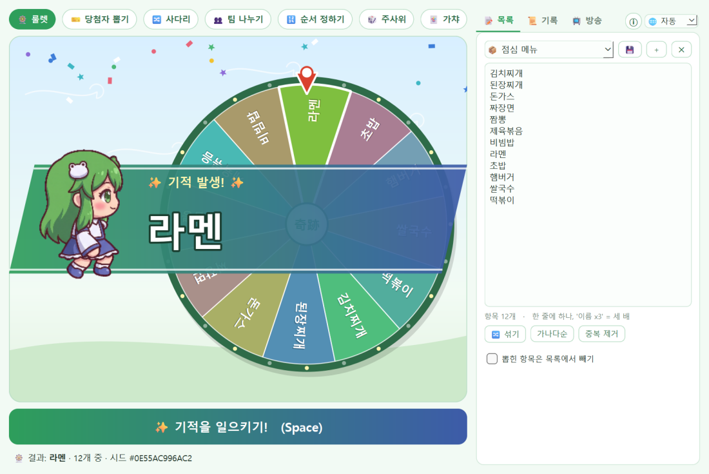

모리야 신사의 무녀 **코치야 사나에**가 기적을 일으켜 뽑아 주는 Windows 추첨 프로그램입니다.
점심 메뉴 고르기부터 방송·카페 이벤트 경품 추첨까지, 목록만 붙여 넣으면 됩니다.

> 동방 프로젝트의 비공식 2차 창작입니다. / 東方Project二次創作です。 / Unofficial Touhou Project fan work.

- **인터넷이 필요 없어요.** 참가자 명단이 밖으로 나가지 않습니다.
- **공정성 기록**: 모든 추첨은 시드 하나로 정해지고 기록에 남습니다. 같은 목록·같은 시드면 언제 다시 해도 같은 결과가 나옵니다.
- **사나에 연출**: 돌리는 동안 고헤이를 휘두르고, 결과가 나오면 "✨ 기적 발생!" 컷인과 색종이.
- **한국어 · 日本語 · English**: Windows 언어를 따라가고, 오른쪽 위 🌐 칸에서 바꿀 수 있어요.

## 다운로드

[Releases](../../releases/latest)에서 `SanaeMiracle.exe`를 받아 실행하면 됩니다. Python을 따로 설치할 필요가 없습니다.

- Windows 10/11 64비트용입니다.
- 서명되지 않은 exe라서 처음 실행할 때 "Windows의 PC 보호" 창이 뜰 수 있습니다. **추가 정보 → 실행**을 누르면 됩니다.

## 모드

### 🎡 룰렛

메뉴 고르기, 벌칙 정하기 같은 가벼운 결정에. 칸 넓이는 가중치대로 나뉩니다.

- **뽑힌 항목은 목록에서 빼기**를 켜면 같은 항목이 다시 나오지 않아요 (순서 정하기처럼 쓸 수 있음).

### 🎫 당첨자 뽑기

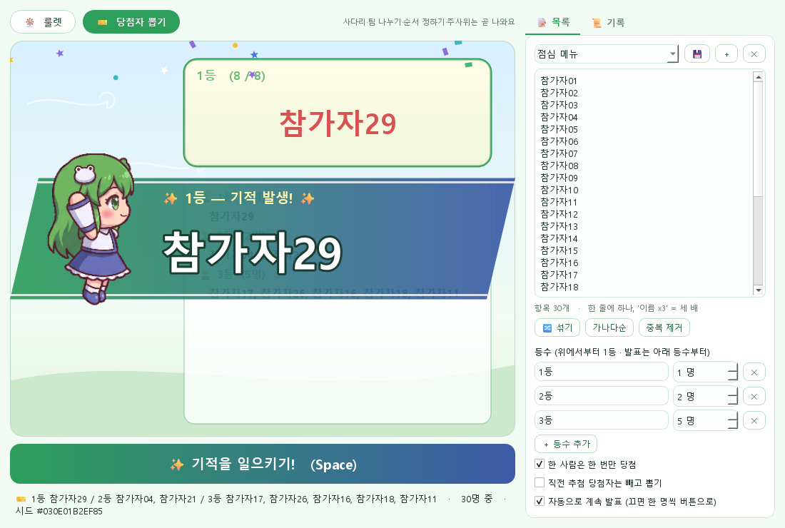

방송·카페·디스코드 이벤트 경품 추첨에.

- **등수**: 1등 1명, 2등 2명, 3등 5명처럼 원하는 만큼. 발표는 낮은 등수부터 한 명씩, 1등은 더 길게 애태웁니다.
- **한 사람은 한 번만 당첨** (응모권을 여러 장 가진 사람도).
- **직전 추첨 당첨자는 빼고 뽑기** — 이벤트를 여러 번 나눠 할 때.
- **자동으로 계속 발표**를 끄면 한 명씩 버튼(또는 Space)으로 넘깁니다.

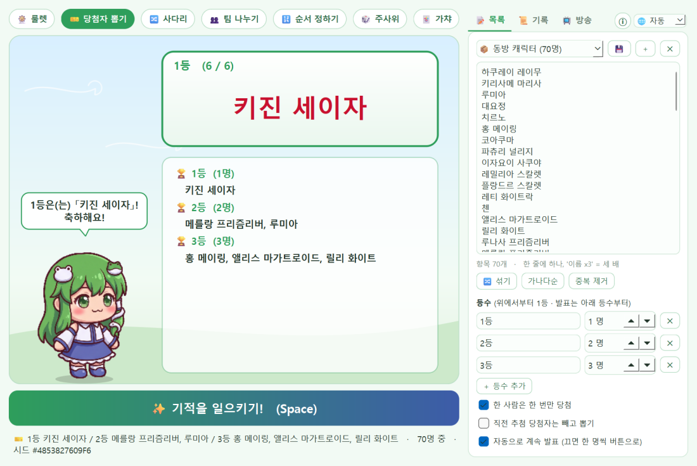

### 🔀 사다리

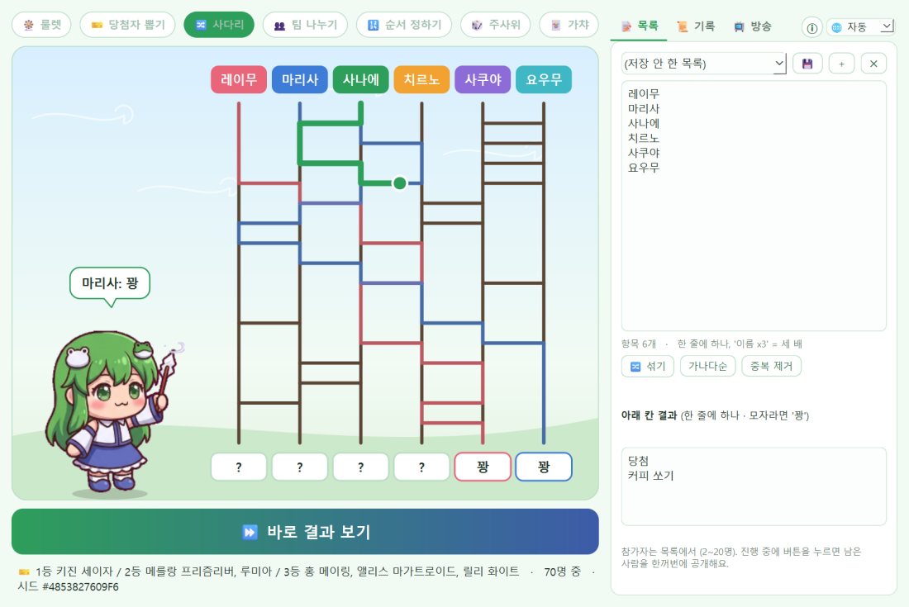

내기, 역할·벌칙 정하기에. 위에는 목록의 참가자(2~20명), 아래 칸에는 결과를 적습니다.

- 결과가 모자라면 나머지는 `꽝`으로 채워요 (비워 두면 `당첨` 하나 + 나머지 꽝).
- 가로줄이 깔린 뒤 한 명씩 색깔 선으로 따라 내려가고, 진행 중에 버튼을 누르면 남은 사람을 한꺼번에 공개합니다.

### 👥 팀 나누기

스터디 조, 게임 팀 편성에. 팀 수(2~12)를 정하면 섞어서 차례로 나눠 줘서 팀 인원 차이는 많아야 1명입니다.

- 팀 이름: `1팀 · 2팀`, **동방 세력**(하쿠레이 · 모리야 · 홍마관 · 영원정 …), 색깔(빨강 · 파랑 …) 중에서.

### 🔢 순서 정하기

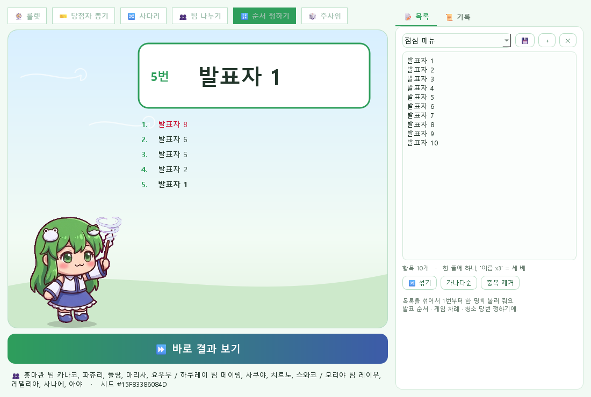

발표 순서, 게임 차례, 청소 당번에. 목록을 섞어서 1번부터 한 명씩 불러 줍니다.

### 🎲 주사위 · 동전 · 숫자

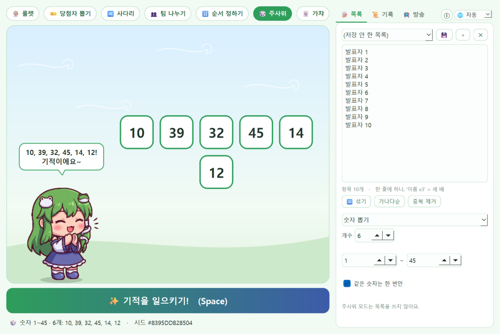

- **주사위**: 1~10개, d4 · d6 · d8 · d10 · d12 · d20 · d100 (여러 개면 합계도).
- **동전 던지기**: 앞 / 뒤.
- **숫자 뽑기**: 범위 안에서 원하는 개수만큼 (같은 숫자는 한 번만 옵션).

### 🃏 가챠

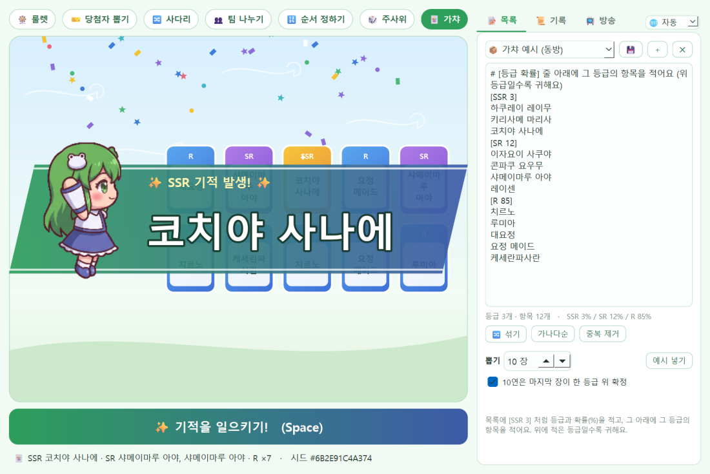

방송 시청자 이벤트, 모임 뽑기 놀이에. 목록에 등급과 확률을 적으면 카드가 한 장씩 뒤집힙니다.

```
[SSR 3]
하쿠레이 레이무
코치야 사나에
[SR 12]
이자요이 사쿠야
[R]
치르노
루미아
```

- `[등급 확률]` 줄 아래에 그 등급의 항목을 적어요. **위에 적은 등급일수록 귀합니다.**
- 확률을 안 적은 등급은 남은 확률을 나눠 가지고, 합이 100을 넘으면 비율대로 맞춰요.
- 1~10장 뽑기. **10연은 마지막 장이 한 등급 위 확정** 옵션 (10장이 모두 가장 흔한 등급이 될 때만 마지막 장을 다시 뽑아요).
- 가장 귀한 등급은 뒤집히기 전에 금빛으로 반짝이고, 나오면 컷인.
- **예시 넣기**를 누르면 동방 캐릭터로 된 예시가 들어갑니다.

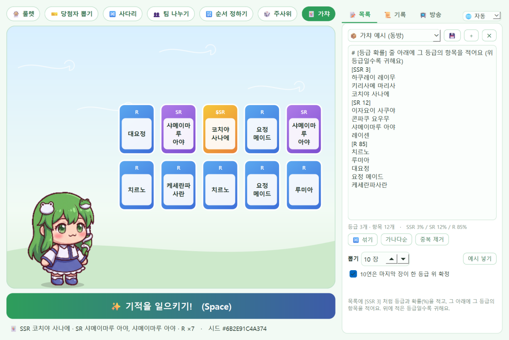

> 가중치(`이름 x3`)는 룰렛 · 당첨자 뽑기에서만 쓰고, 사다리 · 팀 · 순서는 한 줄이 한 명입니다.

## 📺 방송 모드 · 🔊 효과음

오른쪽 **📺 방송** 탭에서 켭니다.

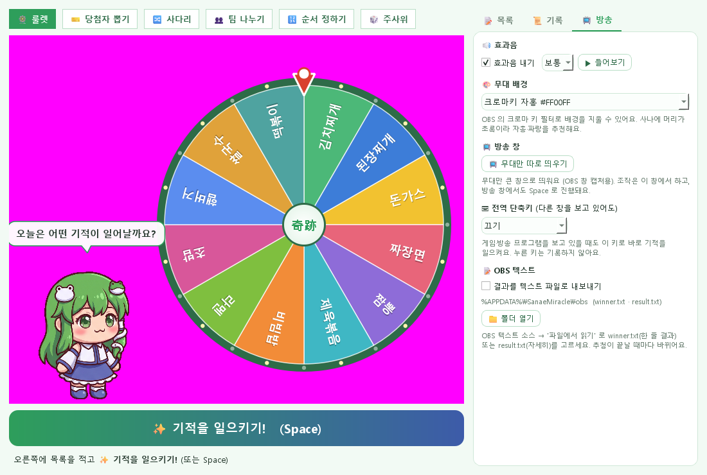

- **🔊 효과음** (작게 · 보통 · 크게): 룰렛 바늘 틱틱, 당첨자 발표 드럼롤, 딩동, 주사위 달그락, 동전, 결과 팡파르.
  소리 파일 없이 코드로 만든 소리라 방송에 써도 저작권 걱정이 없어요.
- **🎨 무대 배경**: 하늘 / **크로마키** 자홍 · 파랑 · 초록. OBS 의 크로마 키 필터로 배경만 지울 수 있어요
  (사나에 머리가 초록이라 자홍·파랑 추천). 크로마키일 땐 그림자를 그리지 않아 테두리가 깔끔합니다.
- **📺 무대만 따로 띄우기**: 무대만 큰 창(1280×720, 크기 조절 가능)으로 떼어 냅니다. OBS 에서는 이 창만 캡처하고,
  조작은 원래 창에서 하면 돼요. 방송 창에서도 Space 로 진행됩니다. 창을 닫으면 무대가 돌아와요.
- **⌨ 전역 단축키** (Ctrl+Alt+M · Ctrl+Alt+Space · F9): 게임이나 방송 프로그램을 보고 있어도 바로 기적을 일으킵니다.
  정해 둔 키 조합만 받고, 다른 키 입력은 읽거나 기록하지 않아요.
- **📝 OBS 텍스트**: 추첨이 끝날 때마다 `%APPDATA%\SanaeMiracle\obs` 에 `winner.txt`(한 줄 결과)와 `result.txt`(자세히)를 씁니다.
  OBS 텍스트 소스 → "파일에서 읽기"로 고르면 화면 자막이 저절로 바뀌어요.

## 목록 적는 법

| 적는 법 | 뜻 |
| --- | --- |
| 한 줄에 하나 | `사나에` ⏎ `레이무` ⏎ `마리사` |
| `이름 x3` (또는 `이름*3`, `치킨x3`) | 가중치 3 — 세 배로 잘 뽑힘 (당첨자 뽑기에선 응모권 3장) |
| 한 줄에 쉼표 | `짜장, 짬뽕, 볶음밥` |
| 엑셀에서 복사해 붙이기 | 칸마다 하나로 나뉨 |
| `#` 로 시작하는 줄 | 메모 (무시) |

목록은 이름을 붙여 저장해 두고 다시 불러올 수 있고, 🔀 섞기 · 가나다순 · 중복 제거도 됩니다.

**📦 기본 목록**: 동방 캐릭터(70명) · 동방 정규작 · 점심 메뉴 · 벌칙 · 가챠 예시가 처음부터 들어 있어요 (언어마다 그 언어로).
고쳐서 저장하면 내 목록이 되고, 기본 목록 자체는 지워지지 않습니다.

## 🌐 언어 · 言語 · Language

한국어 · 日本語 · English. 처음엔 Windows 언어를 따라가고, 오른쪽 위 🌐 칸에서 바꾸면 다시 시작해서 적용돼요.

日本語・English にも対応しています。右上の 🌐 から切り替えられます。 /
Also available in Japanese and English — switch from the 🌐 box at the top right.

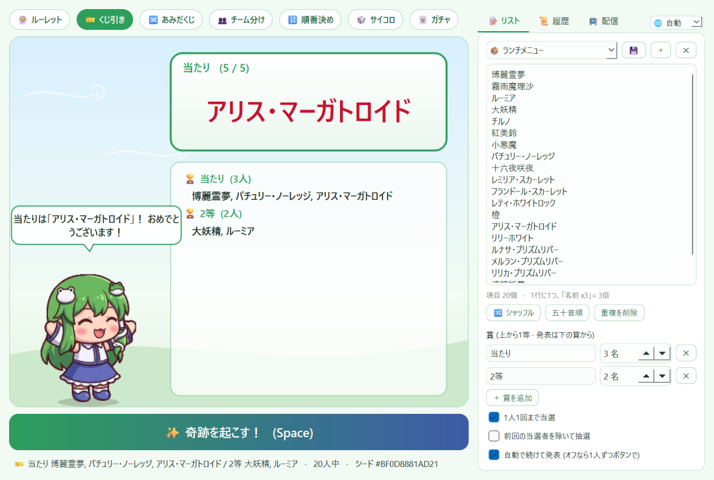 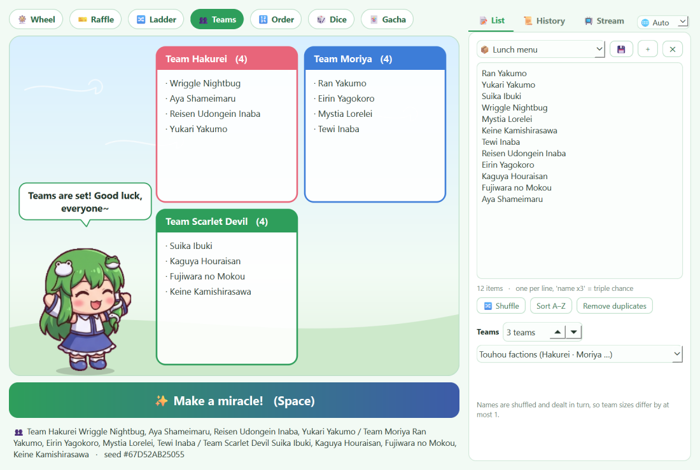

## 단축키

| 키 | 동작 |
| --- | --- |
| Space / Ctrl+Enter / F5 | ✨ 기적을 일으키기 (당첨자 뽑기 중이면 다음 발표, 사다리 · 팀 · 순서 · 주사위 · 가챠 진행 중이면 바로 결과) |
| 전역 단축키 (📺 방송 탭에서 선택) | 다른 창을 보고 있어도 위와 같은 동작 |

## 기록과 공정성

📜 기록 탭에 추첨마다 **시각 · 목록 · 결과 · 시드 · 목록 지문**이 남습니다 (최근 500개).

- **결과 복사**: 공지에 바로 붙여 넣을 수 있는 글로 복사합니다.
- **CSV 저장**: 기록 전체를 엑셀에서 열 수 있게 저장합니다.
- 시드는 매번 운영체제의 안전한 난수로 새로 만들어집니다. 목록 지문(목록 내용으로 만든 짧은 해시)으로 같은 목록이었는지 확인할 수 있습니다.

## 데이터

목록 · 기록 · 설정은 `%APPDATA%\SanaeMiracle` 에 저장됩니다. 지우려면 프로그램을 끄고 이 폴더와 exe를 지우면 됩니다.

## 앞으로

- [x] v0.1 — 룰렛, 당첨자 뽑기, 목록 저장, 기록·공정성, 사나에 연출
- [x] v0.2 — 사다리타기, 팀 나누기, 순서 정하기, 주사위·동전·숫자
- [x] v0.3 — 방송 모드 (크로마키 배경, 방송 창, 전역 단축키, OBS 텍스트), 효과음
- [x] v0.4 — 가챠 모드, 기본 목록(동방 캐릭터 등), 일본어·영어
- [ ] 스와코·카나코 카메오

## 직접 실행 · 빌드

```
pip install -r requirements.txt
python sanae_picker.pyw          # 실행
python tests/smoke.py            # 시험 (화면에 띄우지 않음)
pip install pyinstaller
python build.py                  # dist\SanaeMiracle.exe
```

`v*` 태그를 올리면 GitHub Actions가 시험 → exe 빌드 → 릴리스까지 합니다.

## License

소스 코드는 [MIT License](LICENSE)입니다.

코치야 사나에는 ZUN / 상하이 앨리스 환악단의 동방 프로젝트 캐릭터이며, 권리는 원작자에게 있습니다.
이 프로그램은 공식과 관계없는 비상업 2차 창작입니다. 원작 게임의 그림·음악 소재는 쓰지 않았으며,
사나에 그림은 제작자가 이미지 생성 도구로 새로 만든 것입니다.
